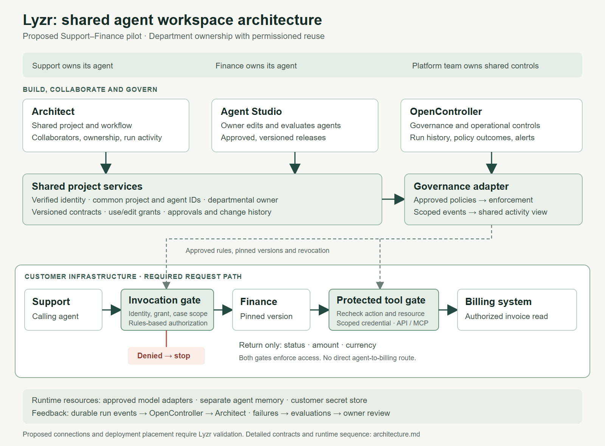

# Lyzr shared agent workspace

A proposal for a shared Architect–Studio workspace where departments own their agents and other teams reuse them with explicit permissions. The Support–Finance example connects shared ownership, OpenController governance and a small customer pilot.

## Assignment files

| File | Contents |
|---|---|
| [architecture.md](architecture.md) | Component architecture, ownership, permission contracts, request flow, deployment and evaluation design |
| [architecture.png](architecture.png) | Architecture overview |
| [presentation.pptx](presentation.pptx?raw=true) | Seven-slide presentation |

This repository contains a proposed design and presentation. It does not contain an implemented platform or completed customer pilot.

Prepared by Rishi Muni Kesarwani.
