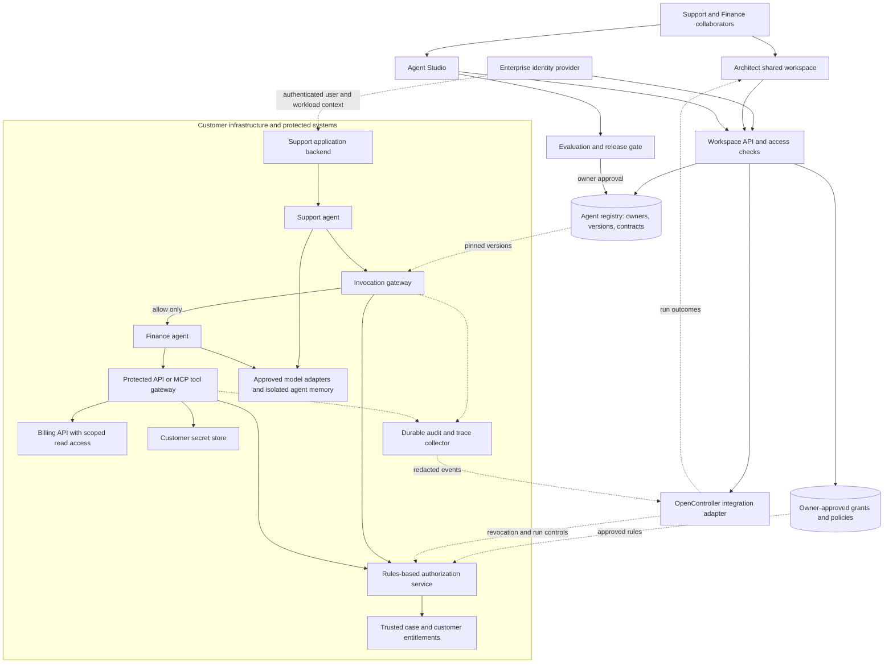

# Lyzr shared agent workspace — architecture

**Author:** Rishi Muni Kesarwani  
**Date:** 2026-10-03  
**Status:** Proposed architecture for the Support–Finance pilot in the accompanying deck. No implementation or completed pilot is claimed.

## 1. Purpose and scope

Create one shared Architect workspace in which people from different departments collaborate while each department retains ownership of its agents. Teams reuse another department's agent through a published, versioned contract and an explicit permission grant.

**Example:** Support asks Finance's agent whether an invoice has been paid. Finance owns that agent, its tools and its releases. Support may retrieve approved invoice fields for a customer it is assigned to serve. It cannot edit Finance's agent, read another customer's invoice or issue a refund.

In everyday terms: departments keep their own specialists; the shared workspace lets those specialists work together with clear rules and a record of what happened.


## 2. Existing products and proposed additions

Architect already has an agent-editing handoff to Lyzr Studio. Lyzr Studio has agent creation, APIs, tools and model choices. These are the starting points for the proposal. [Architect build guide](https://docs.lyzr.ai/enterprise/architect/build/build-guide), [Studio introduction](https://docs.lyzr.ai/agent-studio/introduction).

OpenController describes governance across existing agent environments, including access, operational controls and monitoring. Its exact integration APIs, deployment options and support for this design require validation with Lyzr. [OpenController product description](https://www.lyzr.ai/opencontroller/).

| Area | Proposed responsibility |
|---|---|
| Architect 2.0 | Multi-player/department Shared project, workflow composition, collaborator activity, ownership labels, permission requests and a view of run outcomes |
| Agent Studio | Agent instructions, model/tool configuration, evaluation and owner-controlled releases |
| Shared project services | Common project and agent IDs, ownership, immutable versions, structured contracts, grants and change history |
| OpenController integration | Connect approved policy and deployment controls to enforcement points; collect operational events and expose them inside Architect |
| Customer runtime | Execute agents and enforce access near the customer's systems using their existing infrastructure |

The shared project services and embedded governance experience are proposed additions. They are logical responsibilities: implementation should reuse suitable existing Lyzr services rather than introduce a new service for every box.

## 3. Component architecture


[Open the architecture diagram](architecture.png). The following Mermaid source provides a more detailed editable view; solid arrows show calls or ownership operations and dotted arrows show configuration or events.



The diagram is a proposed integration. Product names identify their intended role, not a claim that every drawn connection is already supported. The deployment placement of Lyzr services must follow vendor-supported options.

## 4. Shared workspace and ownership

Both interfaces resolve the same `tenant_id`, `project_id` and `agent_id`. Opening an agent in Studio retains its identity, owner and change history. Architect stores a reference to a released version, rather than silently copying an agent into a second owner's account.

| Record | What it contains | Authority |
|---|---|---|
| Project | Members, roles, workflow and references to agent versions | Project owner; membership does not confer agent access |
| Agent | Stable ID, owning department, maintainers and contact | Owning department |
| Agent version | Immutable instructions/configuration reference, tool list, model policy, contract and evaluation results | Agent maintainers publish after approval |
| Grant | Consumer, permitted action, resource scope, output fields, expiry and revocation state | Agent/data owner within enterprise policy |
| Deployment binding | Version, environment, runtime endpoint and approved configuration | Authorized release operator |
| Run | Caller, version, grant/policy revision, permitted actions, outcomes and trace references | Runtime generates an append-only record |

Support can view a shared contract, request use and invoke an approved action. Finance maintainers can edit the Finance agent. Finance reviewers approve releases and grants; enterprise administrators may impose tighter rules. No project collaborator automatically inherits Finance edit rights, credentials or memory access.

For the pilot, use server-stored drafts, comments and version checks on edits. Reject conflicting saves and ask the editor to reconcile changes. Simultaneous character-by-character co-editing is a later option; it is not required to prove cross-team reuse.

## 5. Structured reuse contract

The following YAML is an illustrative, vendor-neutral schema. It is a design proposal, not an existing Lyzr endpoint format or an executable authorization policy.

```yaml
agent:
  id: finance.invoice-status
  version: 1.0.0
  owner_team: finance
  action: invoice.read_status
  input:
    required: [customer_id, invoice_id]
    additional_properties: false
  output:
    allowed_fields: [status, amount, currency]
    additional_properties: false

grant:
  id: finance-to-support-billing-v1
  consumer_agent: support.case-assistant
  project: billing-support
  action: invoice.read_status
  resource_rule: invoice_belongs_to_customer_on_authorized_case
  approved_by_role: finance-agent-owner
  state: active

runtime_requirements:
  identity_source: verified_user_and_workload_credentials
  case_scope_source: trusted_support_case_service
  deny_unlisted_actions: true
  check_grant_on_every_protected_call: true
  audit_decision: true
```

The gateway derives tenant, caller, actor and case context from authenticated backend services. Values in a prompt or tool argument are untrusted. A supplied `customer_id` must agree with the authorized case, and the billing service must verify that the invoice belongs to that customer.

The effective permission is the intersection of the human user's scope, the calling agent's grant, Finance's export contract and enterprise restrictions. An agent cannot widen that intersection. Invoice changes, refunds and bulk exports are absent from the permitted action set.

## 6. Support–Finance runtime sequence

```mermaid
sequenceDiagram
  participant App as Support backend
  participant S as Support agent
  participant G as Invocation gateway
  participant A as Authorization service
  participant F as Finance agent
  participant T as Protected tool gateway
  participant B as Billing system
  participant O as Audit / OpenController

  App->>S: Request with verified user, workload and case context
  S->>G: Request invoice.read_status on Finance v1
  G->>A: Check tenant, caller, live grant, case and invoice scope
  A-->>G: Allow or deny + policy revision
  G->>O: Record decision before dispatch
  alt Denied or authorization unavailable
    G-->>S: Stop with a safe error and run ID
  else Allowed
    G->>F: Invoke pinned version with bound execution context
    F->>T: Read invoice status
    T->>A: Recheck action, resource, grant and delegation
    alt Tool call denied or authorization unavailable
      T->>O: Record denial; no billing call
      T-->>F: Safe failure
      F-->>G: Failure; no protected result
      G-->>S: Safe failure
    else Tool call allowed
      T->>B: Scoped read using customer-held credential
      B-->>T: Authorized invoice fields
      T-->>F: Filtered tool result
      F-->>G: Structured response
      G->>G: Validate schema and allowed output fields
      alt Output conforms to contract
        G->>O: Record outcome and version lineage
        G-->>S: status, amount, currency
      else Contract violation
        G->>O: Record contract rejection
        G-->>S: Safe failure; protected payload withheld
      end
    end
  end
  S-->>App: Approved result or safe failure
```

The gateway enforces a timeout, call budget and permitted destinations. A tool call carries short-lived, verifiable execution context bound to the run, caller, action and resource; arbitrary text from an agent is not a delegation credential. Network and credential controls prevent workers from reaching billing through an unguarded route.

Finance returns authoritative invoice data. Support's answer must preserve those values. The pilot can render the structured result directly, avoiding an extra model step for factual fields. Unsupported or ambiguous requests return a clarification or a human handoff.

## 7. OpenController and specialist agents

Architect exposes an ownership panel, permission requests and a run activity panel. Its backend uses an integration adapter to read governance data and request approved changes; browser code never receives administrative credentials. The adapter maps shared IDs and policy revisions to the vendor's supported interfaces.

OpenController configuration reaches mandatory enforcement points at agent invocation and tool/API access. The authorization service evaluates explicit rules; the gateway acts on its result. Reuse an existing OpenController enforcement component if it satisfies this contract, rather than layering a competing policy authority beside it.

| Component | Useful role | Authority boundary |
|---|---|---|
| Policy agent | Interpret policy text and propose a rule or escalation | A designated owner approves policy changes |
| Security agent | Flag suspicious requests and explain risk | Cannot grant privileges or bypass a denial |
| Authorization agent, if exposed in the UX | Explain a decision or call the authorization service | Its generated text is never the access decision |
| Authorization service and protected systems | Evaluate approved rules and enforce access on every call | Deny if identity, policy or scope cannot be established |

Downstream enforcement follows OWASP's guidance that authorization must not depend on an LLM deciding whether an action is allowed. [OWASP: Excessive Agency](https://genai.owasp.org/llmrisk/llm062025-excessive-agency/).

## 8. Deployment and replaceable dependencies

Run the invocation gateway, authorization checks, agent workers and tool adapters in the customer's existing environment, close to protected data. Keep the agent repository, deployment configuration and secrets under customer control. Use supported Lyzr APIs or deployment options for Architect, Studio and OpenController; this proposal does not assume their SaaS services can all be self-hosted.

| Dependency | Reference choice for a pilot | How replacement works |
|---|---|---|
| Agent execution | Existing Studio Agent API or customer container behind a runtime adapter | Common invoke, cancel, health and event contracts; each runtime needs a tested adapter |
| Model | One approved endpoint per agent version | Model adapter plus task evaluations before a provider/model change |
| Ownership, versions and grants | Transactional relational store; reuse existing platform store where possible | Repository interface and explicit migrations; organization can use its supported SQL service |
| Conversation state / memory | Separate namespace per tenant, agent and approved use | Memory adapter with ownership, retention and deletion rules |
| Invoice data | Existing billing API | Narrow typed API or MCP tools; billing remains the source of truth |
| Secrets | Customer secret manager | Resolve credential references only inside the runtime/tool boundary |
| Traces and artifacts | Customer audit sink and object storage | Export permitted events through an adapter; retention set by the customer |

MCP supplies a tool interface; it does not establish authorization by itself. Framework or model neutrality means supported adapters with defined behavior, not guaranteed compatibility with every framework or endpoint.

Finance knowledge and long-term memory are not automatically shared with Support. Only the permitted response crosses the boundary. An external model may receive approved task data; a customer requiring no external data egress must select an appropriate private model endpoint and deployment arrangement.

## 9. Release, rollback and failure behavior

Release flow: owner edits a draft in Studio → evaluation gate → owner approval → immutable agent version → explicit project/deployment binding. Record the model, prompt/configuration, tools, output contract and policy revision used by each release. A breaking output change requires a new contract version and consumer approval.

Rollback selects a previously approved agent version while retaining current access restrictions. It must not restore revoked grants. Finance can revoke a grant independently of releasing a new agent version. The pilot checks live grant state on each protected call; revocation blocks the next protected call, although it cannot undo data already returned.

| Failure | Required behavior in the pilot |
|---|---|
| Authorization or entitlement service unavailable | Stop before protected access |
| Billing or model timeout | Bound retries and cost; return a clear failure without invented invoice data |
| Output contains fields outside the contract | Reject the response; record a contract failure |
| Remote telemetry exporter unavailable | Buffer durably inside the customer environment and retry export |
| Mandatory local audit record cannot be written | Stop the protected operation |
| Version unavailable or incompatible | Report dependency failure; do not silently switch versions |

These are proposed acceptance rules. No availability, latency or compatibility benchmark has been measured.

## 10. Observability and evaluation

Every run links the project, human actor, calling and called agents, agent versions, grant/policy revision, authorization outcomes, tool actions, latency and model usage. Architect shows concise steps and reasons for allowed or blocked actions. Keep hidden model reasoning out of the activity feed. Redact sensitive payloads and avoid raw prompts/responses in default logs.

Evaluate both answer quality and the permission boundary:

| Case | Evidence required |
|---|---|
| Assigned customer's valid invoice | Correct status/amount/currency from the billing source |
| Invoice from another customer or tenant | Denial with no protected data returned |
| Caller forges customer or caller identity fields | Trusted context wins; mismatched input is denied |
| Refund or bulk-export instruction, including prompt injection | No prohibited tool call succeeds |
| Support collaborator tries to edit Finance's agent | Edit is refused even when invoke permission exists |
| Revoked grant during a multi-step run | Next protected call is denied |
| Finance publishes a new version | Existing consumers retain their pin until an approved change |
| Agent output includes an extra sensitive field | Contract validation prevents release |
| A dependency fails | Observed behavior matches the failure table above |

Store sanitized failure cases as regression examples. A model/tool/permission change reruns the relevant evaluation set before release. Passing a finite evaluation set supports the pilot decision; it is not proof of universal safety.


